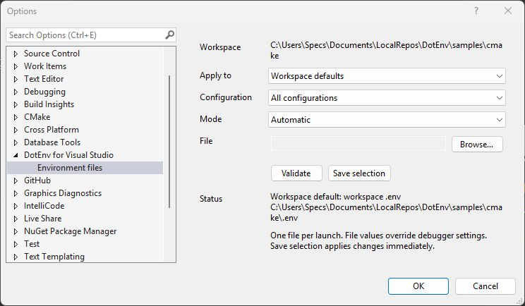
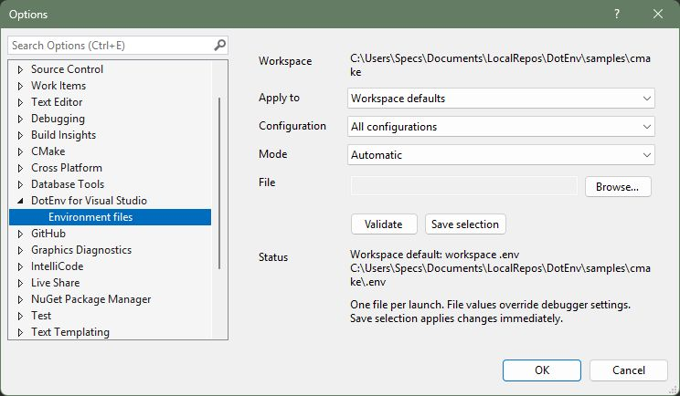

# Marketplace listing draft — not ready to publish

Display name: **DotEnv for Visual Studio**

Publisher display name: **Israel Bravo**

Preferred publisher identifier: `bravo-is` (availability not yet confirmed).

Preferred internal listing name: `DotEnvForVisualStudio` (availability not yet confirmed).

Short description: Load `.env` files when debugging native C++ solutions and CMake projects. Simple local settings and configuration overrides.

## Overview copy

### Environment files, ready for F5

1. Install **DotEnv for Visual Studio** and restart Visual Studio.
2. Put `.env` beside your `.vcxproj`, or in your opened CMake folder.
3. Press **F5**.

Exactly one file is read for each launched process, every time. Native solution projects fall back to the solution directory's `.env` when no project file is present. No automatically discovered file means debugging proceeds normally.

### Choose a different file

Open **Tools → DotEnv for Visual Studio**, choose your project or target, choose **All configurations** or a specific configuration, and browse to your file. Validate and save. Settings stay local; no scripts or project-file edits are required.

Files can come from any tool. Values remain literal: Windows paths work without shell escaping, and the extension never executes commands or interpolates values.

### Supported workflows

Version 1 targets local native C++ F5 in solution projects and CMake folders, using Visual Studio 2022 17.12+ or Visual Studio 2026 on x64 Windows. C#, remote/WSL, attach-to-process, ARM64 Visual Studio, and Ctrl+F5 are outside the initial support promise.

Free and MIT-licensed. No telemetry or external network calls. Output diagnostics identify paths and errors without logging environment values.

## Publication assets and gates

- Icon: `assets/icon.png`, 90 × 90.
- License: `LICENSE`.
- Privacy statement: `PRIVACY.md`.
- Repository: https://github.com/bravo-is/DotEnv-VS
- Support/issues: https://github.com/bravo-is/DotEnv-VS/issues
- Screenshots: `docs/images/automatic-detection.jpg` and `docs/images/configuration-override.jpg`, captured from the running VS2022 extension. Upload these as listing assets and replace relative image links with the assigned asset URLs. Recapture if the final UI changes.
- Release notes: final 1.0 entry from `CHANGELOG.md`.
- Compatibility: verify the complete [acceptance matrix](release-validation.md) before submitting the claims above.

Do not upload this draft or the 0.9.0 development installer as the 1.0 public release.
